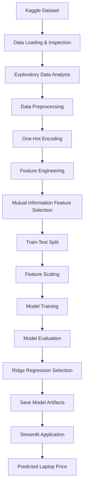

# 💻 Laptop Price Prediction | Machine Learning

<p align="center">
  
  
  
  
</p>

<p align="center">
  A Machine Learning-based laptop price prediction system that estimates laptop prices using hardware specifications, brand information, and technical configurations.
</p>

---

## 📌 Project Overview

Laptop prices are influenced by several factors, including brand reputation, processor performance, RAM capacity, storage configuration, graphics hardware, display resolution, and physical specifications.

Understanding how these features influence laptop prices can help customers make informed purchasing decisions and provide useful insights into the relationship between hardware configurations and market pricing.

**Laptop Price Prediction** is a supervised Machine Learning regression project developed to estimate laptop prices based on their specifications.

The project follows an end-to-end Machine Learning workflow, beginning with dataset exploration and preprocessing, followed by feature engineering, feature selection, model development, performance evaluation, and deployment through an interactive Streamlit application.

Three regression algorithms — Linear Regression, Ridge Regression, and Lasso Regression — are implemented and compared to identify the best-performing model.

Ridge Regression achieves the highest R² score of **0.7877**, making it the selected model for the prediction system.

## 🎯 Problem Statement

Laptop pricing depends on multiple hardware and configuration-related attributes. However, determining an appropriate price for a laptop based on these specifications can be challenging because different combinations of components contribute differently to its overall value.

The objective of this project is to develop a regression-based Machine Learning model capable of learning relationships between laptop specifications and their corresponding prices.

The trained model is integrated into a Streamlit application where users can select laptop specifications and obtain an estimated price in euros (€).

## 🎯 Project Objectives

- Explore and understand laptop pricing data through Exploratory Data Analysis (EDA).
- Identify important hardware and configuration-related factors influencing laptop prices.
- Perform data cleaning, preprocessing, and feature transformation.
- Apply feature engineering to capture interactions between important hardware specifications.
- Use Mutual Information Regression for feature selection.
- Train and compare multiple regression algorithms.
- Evaluate model performance using R² and Adjusted R² scores.
- Deploy the selected regression model through an interactive Streamlit application.

## ✨ Key Features

- 📊 **Exploratory Data Analysis:** Investigate dataset distributions, feature relationships, and laptop pricing patterns.
- 🧹 **Data Preprocessing:** Convert numerical attributes, transform categorical variables, and prepare data for modeling.
- ⚙️ **Feature Engineering:** Generate additional features representing interactions between RAM, processor information, screen size, and weight.
- 🎯 **Feature Selection:** Apply Mutual Information Regression to identify the 75 most informative features.
- 🤖 **Regression Modeling:** Implement Linear Regression, Ridge Regression, and Lasso Regression.
- 📈 **Model Comparison:** Evaluate and compare regression models using R² and Adjusted R².
- 💾 **Model Persistence:** Save the trained model, scaler, and selected feature columns using Joblib.
- 🌐 **Interactive Prediction:** Provide a Streamlit interface for entering laptop specifications and receiving estimated prices.

## 📂 Dataset Description

The project uses a laptop pricing dataset obtained from **Kaggle**.

The original dataset contains:

| Dataset Property  |       Details |
| ----------------- | ------------: |
| Total Records     |         1,303 |
| Total Columns     |            13 |
| Missing Values    |             0 |
| Duplicate Records |             0 |
| Target Variable   | `Price_euros` |
| Prediction Type   |    Regression |
| Target Currency   |      Euro (€) |

### Dataset Features

The dataset contains information about laptop brands, product configurations, hardware components, and pricing.

| Feature            | Description                                   |
| ------------------ | --------------------------------------------- |
| `laptop_ID`        | Unique laptop identification number           |
| `Company`          | Laptop manufacturer                           |
| `Product`          | Laptop product/model name                     |
| `TypeName`         | Laptop category or form factor                |
| `Inches`           | Display size in inches                        |
| `ScreenResolution` | Display resolution and screen characteristics |
| `Cpu`              | Processor specifications                      |
| `Ram`              | Installed RAM capacity                        |
| `Memory`           | Storage configuration                         |
| `Gpu`              | Graphics processing unit                      |
| `OpSys`            | Operating system                              |
| `Weight`           | Laptop weight in kilograms                    |
| `Price_euros`      | Laptop price in euros (target variable)       |

### Target Variable

The target variable is:

```python
Price_euros
```

This is a continuous numerical variable, making the problem a supervised regression task.

The model learns from the relationship between the laptop specifications and their corresponding prices to estimate prices for previously unseen configurations.

## 🛠️ Technology Stack

| Technology       | Purpose                                                      |
| ---------------- | ------------------------------------------------------------ |
| Python           | Core programming language                                    |
| NumPy            | Numerical computation                                        |
| Pandas           | Data manipulation and analysis                               |
| Matplotlib       | Data visualization                                           |
| Seaborn          | Statistical visualization                                    |
| Scikit-learn     | Preprocessing, feature selection, regression, and evaluation |
| Joblib           | Saving and loading trained model artifacts                   |
| Streamlit        | Interactive web application                                  |
| Jupyter Notebook | Model development and experimentation                        |

## 🔄 Project Workflow

The project follows a structured Machine Learning pipeline.



## 📊 Exploratory Data Analysis (EDA)

Exploratory Data Analysis is performed to understand the dataset's structure, distributions, and relationships between different laptop attributes.

The initial analysis includes:

- Inspecting dataset dimensions and column names.
- Examining data types and statistical summaries.
- Checking missing values and duplicate records.
- Exploring categorical feature distributions.
- Understanding numerical feature distributions.
- Investigating relationships between laptop specifications and prices.

### Initial Data Quality Assessment

The dataset contains 1,303 observations and 13 columns.

The initial inspection identifies:

- No missing values across the dataset.
- No duplicate records.
- Numerical attributes stored in both numerical and string formats.
- Several categorical attributes containing multiple unique hardware configurations.

These observations guide the preprocessing and feature transformation stages.

## 🧹 Data Preprocessing

Data preprocessing prepares the raw dataset for Machine Learning by converting attributes into appropriate numerical representations.

The following operations are performed:

### 1. Removing Unnecessary Columns

The `laptop_ID` column is removed because it represents an identification number rather than a meaningful hardware characteristic for price prediction.

### 2. Numerical Feature Conversion

Some numerical attributes contain measurement units as part of their values.

The following transformations are applied:

- `Ram`: Remove the GB suffix and convert values into integers.
- `Weight`: Remove the kg suffix and convert values into floating-point numbers.

This allows the Machine Learning algorithms to process these attributes numerically.

### 3. Categorical Feature Encoding

Most laptop specifications are categorical, such as manufacturer, processor, graphics hardware, storage configuration, and operating system.

One-Hot Encoding is applied to transform categorical values into numerical indicator columns.

This creates a numerical representation that can be used by regression algorithms.

## ⚙️ Feature Engineering

Feature engineering is performed to capture additional relationships between laptop specifications that may influence pricing.

Three interaction features are created:

| Engineered Feature | Description                                                           |
| ------------------ | --------------------------------------------------------------------- |
| `Ram_x_Weight`     | Interaction between RAM capacity and laptop weight                    |
| `Ram_x_Inches`     | Interaction between RAM capacity and screen size                      |
| `Ram_x_Cpu_Tier`   | Interaction between RAM capacity and the CPU indicator representation |

These features help the model represent combinations of hardware attributes rather than relying exclusively on individual features.

After one-hot encoding and interaction feature generation, the engineered feature matrix contains **957 predictor columns**.

## 🎯 Feature Selection

High-dimensional categorical encoding can produce a large number of features. Using every feature may introduce unnecessary complexity.

To identify informative predictors, the project uses:

**Mutual Information Regression**

Mutual Information Regression measures how much information an individual feature provides about a continuous target variable.

The feature selection process involves:

1. Calculating mutual information scores for the engineered features.
2. Ranking features according to their scores.
3. Selecting the top 75 features.
4. Constructing the final modeling dataset using the selected features and target variable.

<details>
<summary><b>Feature selection implementation</b></summary>

```python
from sklearn.feature_selection import mutual_info_regression

X_engineered = df_one_hot_encode.drop(
    columns=["Price_euros"]
).copy()

X_engineered["Ram_x_Weight"] = (
    X_engineered["Ram"] * X_engineered["Weight"]
)

X_engineered["Ram_x_Inches"] = (
    X_engineered["Ram"] * X_engineered["Inches"]
)

cpu_cols = [
    col for col in X_engineered.columns
    if "Cpu_" in col
]

if cpu_cols:
    X_engineered["Ram_x_Cpu_Tier"] = (
        X_engineered["Ram"] *
        X_engineered[cpu_cols].sum(axis=1)
    )

y_full = df_one_hot_encode["Price_euros"]

mi_scores = mutual_info_regression(
    X_engineered,
    y_full,
    random_state=42
)

mi_scores = pd.Series(
    mi_scores,
    index=X_engineered.columns
)

cols_to_keep = (
    mi_scores.sort_values(ascending=False)
    .head(75)
    .index.tolist()
)

final_df = X_engineered[cols_to_keep].copy()
final_df["Price_euros"] = y_full
```

</details>

## 📐 Train-Test Split and Feature Scaling

The selected features are separated into independent variables (X) and the target variable (y).

The dataset is divided using:

- Training Set: 67%
- Testing Set: 33%
- Random State: 42

`StandardScaler` is applied to standardize the numerical feature values.

The scaler is fitted using the training data and then used to transform both training and testing data.

This ensures that feature scaling parameters are learned from the training set.

## 🤖 Machine Learning Models

Three regression algorithms are implemented and evaluated.

### 1. Linear Regression

Linear Regression establishes a baseline relationship between input features and the continuous target variable.

It attempts to minimize the difference between actual and predicted laptop prices by fitting a linear equation.

### 2. Ridge Regression

Ridge Regression is a regularized version of Linear Regression that introduces an L2 penalty to reduce the impact of large model coefficients.

It helps control model complexity, particularly when working with numerous correlated features.

Configuration:

```python
Ridge(alpha=1.0)
```

### 3. Lasso Regression

Lasso Regression introduces an L1 regularization penalty.

It can reduce less influential coefficients toward zero, helping simplify the model.

Configuration:

```python
Lasso(alpha=0.01)
```

## 📈 Model Evaluation and Comparison

The regression models are evaluated using two metrics:

### R² Score (Coefficient of Determination)

R² measures how well the model explains variations in the target variable.

A higher R² score generally indicates better explanatory performance on the evaluated dataset.

### Adjusted R² Score

Adjusted R² accounts for the number of predictors used by the model relative to the number of observations.

It provides an additional perspective when evaluating models with multiple features.

### Model Performance Results

The following results are taken from the model comparison performed in the notebook.

| Regression Model     |   R² Score | Adjusted R² |
| -------------------- | ---------: | ----------: |
| Linear Regression    |     0.7850 |      0.7394 |
| **Ridge Regression** | **0.7877** |  **0.7427** |
| Lasso Regression     |     0.7854 |      0.7399 |

<details>
<summary><b>Model comparison implementation</b></summary>

```python
models = {
    "Linear Regression": LinearRegression(),
    "Ridge Regression": Ridge(alpha=1.0),
    "Lasso Regression": Lasso(alpha=0.01)
}

results = []

for name, model in models.items():

    model.fit(X_train_scaled, y_train)

    y_pred = model.predict(X_test_scaled)

    r2 = round(
        r2_score(y_test, y_pred), 4
    )

    n = X_test.shape[0]
    p = X_test.shape[1]

    adjusted_r2 = round(
        1 - ((1-r2)*(n-1)/(n-p-1)), 4
    )

    results.append({
        "Model": name,
        "R2 Score": r2,
        "Adjusted R2 Score": adjusted_r2
    })
```

</details>

### 🏆 Best Performing Model: Ridge Regression

Ridge Regression achieves the highest R² score of **0.7877** and Adjusted R² score of **0.7427** among the three evaluated algorithms.

Based on this comparison, Ridge Regression is selected as the final model for the laptop price prediction system.

## 💾 Model Serialization

After model comparison, the selected Ridge Regression model and its associated preprocessing artifacts are saved using Joblib.

Three files are generated:

| File                              | Purpose                                                     |
| --------------------------------- | ----------------------------------------------------------- |
| `ridge_laptopPrice_model.pkl`     | Stores the trained Ridge Regression model                   |
| `scaler_laptopPrice.pkl`          | Stores the fitted StandardScaler                            |
| `feature_columns_laptopPrice.pkl` | Stores the selected feature column names and their ordering |

These saved artifacts allow the Streamlit application to reuse the trained model without repeating the complete training process whenever a user requests a prediction.

### Saving the Model

```python
import joblib

joblib.dump(
    models["Ridge Regression"],
    "ridge_laptopPrice_model.pkl"
)

joblib.dump(
    scaler,
    "scaler_laptopPrice.pkl"
)

joblib.dump(
    X.columns.to_list(),
    "feature_columns_laptopPrice.pkl"
)
```

## 🌐 Streamlit Web Application

The trained model is integrated into an interactive Streamlit application.

The application allows users to configure laptop specifications through input controls and receive an estimated laptop price.

### User Input Features

Users can provide the following specifications:

| Input            | Description             |
| ---------------- | ----------------------- |
| Company          | Laptop manufacturer     |
| TypeName         | Laptop category         |
| Inches           | Display size            |
| ScreenResolution | Display configuration   |
| Cpu              | Processor specification |
| Ram              | RAM capacity            |
| Memory           | Storage configuration   |
| Gpu              | Graphics processor      |
| OpSys            | Operating system        |
| Weight           | Laptop weight           |

### Prediction Output

After entering the required specifications, the application processes the inputs using the saved preprocessing artifacts and trained regression model.

The application displays the **predicted laptop price in euros (€)**.

The prediction represents an estimated price based on patterns learned from the historical dataset, rather than a guaranteed current market price.

## 📁 Project Structure

```text
Laptop-Price-Prediction/
│
├── laptop_price_prediction_ml.ipynb
├── laptop_price.csv
│
├── ridge_laptopPrice_model.pkl
├── scaler_laptopPrice.pkl
├── feature_columns_laptopPrice.pkl
│
├── app.py
├── start.sh
├── .gitignore
├── requirements.txt
└── README.md
```

_Note: `app.py` and `requirements.txt` are conventional filenames; adjust them to match the actual filenames in your repository if they differ._

## 🚀 Installation and Setup

Follow these instructions to run the project locally.

### 1. Clone the Repository

```bash
git clone <YOUR_REPOSITORY_URL>
```

### 2. Navigate to the Project Directory

```bash
cd Laptop-Price-Prediction_Regression_ML
```

### 3. Create a Virtual Environment

```bash
python -m venv venv
```

### 4. Activate the Virtual Environment

**Windows:**

```bash
venv\Scripts\activate
```

**macOS / Linux:**

```bash
source venv/bin/activate
```

### 5. Install Dependencies

If your project includes a `requirements.txt` file:

```bash
pip install -r requirements.txt
```

Otherwise, install the required libraries:

```bash
pip install numpy pandas matplotlib seaborn scikit-learn streamlit joblib jupyter
```

### 6. Run the Streamlit Application

```bash
streamlit run app.py
```

The application will start locally and provide a URL that can be opened in your browser.

_Replace `app.py` with your actual Streamlit entry-point filename if necessary._

## 🔍 Important Evaluation Note

In the current notebook, Mutual Information feature selection is performed before the train-test split. Consequently, information from the eventual testing observations can influence which features are selected.

This introduces a potential feature-selection data leakage issue and may make the reported evaluation scores optimistic.

For a more rigorous evaluation, feature selection should be fitted only on the training data, ideally inside a Scikit-learn Pipeline, and then applied to the testing data.

The reported R² and Adjusted R² scores represent the current notebook implementation.

## 📚 Learning Outcomes

Through this project, I gained practical experience in:

- Understanding and implementing supervised Machine Learning regression.
- Performing Exploratory Data Analysis on structured datasets.
- Handling numerical and categorical features.
- Applying One-Hot Encoding and StandardScaler.
- Creating interaction-based engineered features.
- Using Mutual Information for feature selection.
- Implementing Linear, Ridge, and Lasso Regression.
- Comparing models using R² and Adjusted R².
- Saving and reusing trained Machine Learning models with Joblib.
- Integrating a trained model into a Streamlit application.
- Building an end-to-end Machine Learning workflow.

## 👨‍💻 Author

**Shouvanik Santra**

AI/ML Developer | Python | Machine Learning | Data Science

Interested in building intelligent applications, practical Machine Learning projects, and data-driven solutions.

---

<p align="center">
  ⭐ If you find this project interesting, consider giving the repository a star!
</p>
